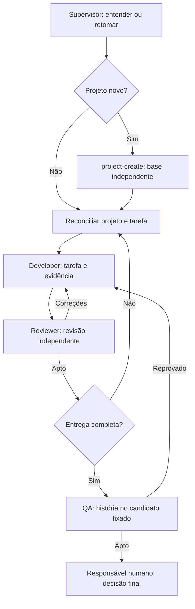

# Fluxo de trabalho com agentes

O fluxo organiza trabalho assistido por IA em quatro papéis. Serve para software, dados, pesquisa, documentos e outros artefatos; tecnologia, nicho, provedor de IA e hospedagem são escolhas do projeto.

## Começar pelo Supervisor

Abra a raiz do template ou do projeto e diga **"Supervisor"**, **"Atue como Supervisor"** ou invoque a skill **supervisor**. A entrada operacional está em [skills/supervisor](../../../skills/supervisor/SKILL.md).

- Sem objetivo informado, o Supervisor pergunta se você quer criar um projeto, preparar um existente ou continuar trabalho.
- Para um projeto novo, coleta objetivo e destino e conduz [project-create](../../../skills/project-create/SKILL.md). Não exige stack definida: pode registrar "a definir" ou "não se aplica".
- Para um projeto existente sem esta base, conduz [project-bootstrap](../../../skills/project-bootstrap/SKILL.md).
- Para atualizar uma base já instalada, conduz [project-update](../../../skills/project-update/SKILL.md).
- Para continuar, reconcilia o estado e escolhe a próxima tarefa autorizada.

Chamar o Supervisor sozinho inicia a conversa; não autoriza criar um projeto sem objetivo e destino. Depois de definidos, ele prepara a base, encaminha a primeira tarefa e continua dentro do escopo autorizado.

## Papéis

| Papel | Responsabilidade | Limite |
| --- | --- | --- |
| [Supervisor](supervisor.md) | Sessão principal: entrada, planejamento, despacho, estado e composição da entrega | Não implementa produto, não emite parecer próprio de código e não decide publicação |
| [Developer](developer.md) | Implementa uma tarefa e suas correções, com validação proporcional | Não revisa nem aprova o próprio trabalho |
| [Reviewer](reviewer.md) | Re-deriva as afirmações da mudança, revisa código ou artefato e aponta riscos | Não implementa a correção que está revisando |
| [QA](qa.md) | Vive a história de uso e verifica o resultado da entrega no candidato fixado | Não substitui revisão técnica nem altera produto para aprovar |
| Responsável humano | Decide escopo, risco aceito, integração final e publicação | As autorizações pertencem à sessão e ao projeto |

O Supervisor pode preparar governança e documentação de um projeto novo por project-create; a restrição a implementar produto não impede essa preparação.

## Ciclo

Uma **tarefa ou fatia** é um incremento revisável. Uma **entrega ou milestone** reúne tarefas que permitem comprovar um resultado completo. Em trabalho pequeno, uma única tarefa pode ser a entrega inteira. SDD permanece opcional e proporcional.

Antes de implementar uma entrega relevante, explicite critérios e uma [história de uso](../../templates/historia-de-uso.md). QA entra quando a entrega está completa; revisão acontece por tarefa.

## Branches e repositórios

O [workflow.json](workflow.json) é declarativo: não executa comandos, cria branches, instala identidades, concede permissões ou ativa agendamento.

O padrão do template é `main` como base de uma branch `codex/<assunto>`, com revisão e QA antes da integração final autorizada. A política vigente está em AGENTS.md; uma descrição de papel não a substitui. Correções seguem a política local de branches e permanecem ligadas à mudança em revisão; não altere a base por inferência.

O perfil opcional com `develop` segue tarefa → branch → PR para develop → revisão → integração autorizada → entrega completa → candidato → QA → PR para main → decisão humana. Só pode ser adotado depois de adaptar e aprovar as instruções do projeto. A presença desse exemplo não altera a política deste template.

Não presuma que a raiz tem Git: uma raiz pode reunir vários repositórios ou conter somente arquivos. Registre os repositórios reais. Em múltiplos repositórios, o candidato identifica a versão de cada um. Sem Git, identifique arquivos por hash; revisão pode acontecer por diff local e relatório, sem PR.

## Despacho, independência e retomada

A sessão principal exerce Supervisor e despacha os demais papéis quando houver ferramenta de delegação disponível e autorizada. Subagentes devolvem a passagem e não encadeiam outros agentes. Confira a capacidade efetiva antes de afirmar separação de papéis.

Passe tarefa, critérios, candidato, caminhos e referências. Para revisão, use contexto novo, sem histórico do implementador e sem seu diagnóstico, hipótese ou conclusão. A falta de contexto essencial deve virar pergunta ao Supervisor.

Se delegação não estiver disponível, use outra sessão ou revisão humana. Trocar o nome do papel na mesma sessão não produz revisão independente: registre **não-independente**. Se independência for requisito da entrega, essa lacuna bloqueia a decisão final.

Use a [passagem](../../templates/passagem-de-papel.md) para registrar resultado, evidência, candidato e próximo responsável. Reconcilie estado local e remoto autorizado antes de confiar em relatos. Após resposta externa incerta, consulte o destino antes de repetir; nunca fabrique progresso com commit vazio ou PR duplicado.

## Candidato e evidência

Fixe a versão com o [manifesto do candidato](../../templates/candidato.md): repositórios e SHAs, ou hashes dos artefatos; ambiente; critérios; versão da história; dados sintéticos; comandos e resultados. Um workspace com alterações locais exige hashes dos arquivos afetados: o SHA sozinho não identifica o que foi testado.

Mudança de código, artefato, base, ambiente, dados relevantes ou roteiro invalida o parecer no escopo afetado. Falha de ambiente é **bloqueado**; defeito reproduzido é **reprovado**; critério comprovado é **apto**. Parecer não é aprovação registrada na plataforma, e aprovação não é integração ou publicação.

Durante QA, mantenha estável o candidato e evite misturar trabalho não relacionado. Correções passam por implementação e revisão e geram novo candidato. Evidência fica em [docs/evidence](../../evidence/README.md), histórias em [docs/historias](../../historias/README.md) e defeitos em docs/tasks/.

## Adaptação ao projeto

Escolha branch, ferramentas de testes, modelo de IA e esforço segundo o trabalho e as capacidades disponíveis. Não há modelo fixo, Playwright obrigatório, GitHub Apps, conta de nuvem ou autorização permanente no template. Uma CLI pode ter sua própria história; pesquisa e documentos usam critérios de qualidade e artefatos observáveis.

As skills são a entrada portátil, sincronizada para Codex e Claude Code. Este template não instala configurações nativas de subagentes nem altera a configuração global do agente. A disponibilidade das ferramentas e de contexto independente deve ser verificada na sessão.

Agendamento é opcional e exige pedido explícito. Ao monitorar, preserve silêncio se nada relevante mudar. Espera por decisão humana, execução em andamento e dependência externa não são travamento.

A [comparação da atualização](atualizacao-do-fluxo.md) registra o que mudou e o que foi generalizado.
